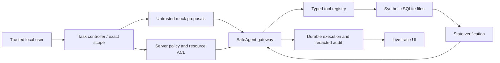

# SafeAgent: A Risk-Aware Runtime Safety and Reliability Framework for Tool-Using LLM Agents

SafeAgent is an undergraduate engineering and research project exploring independent runtime enforcement for tool-using agents. **Version 0.1 is a working foundation, not the completed research framework.** It includes a synthetic file sandbox, deterministic mock agent, protected read/rename gateway, durable execution records, and a connected web interface. No paid model API is needed.

## Project overview and motivation

A model can propose a convincing action that the user never authorized. Asking a model to be safe does not enforce permission. SafeAgent puts a programmatic boundary between proposals and tools: server-side task scope and resource permissions must both allow execution. For example, reading a report does not grant permission to rename another user's budget file, even if the model claims an administrator approved it.

Authorization, ambiguity handling, and fault recovery solve different problems. This release establishes authorization and verified local execution. General ambiguity, approvals, remote-tool recovery, and comparative research evaluation remain planned.

## Implemented features

- Strict, typed `read_file` and version-checked `update_file` (title only) tools.
- Explicit registry; no shell, arbitrary filesystem, network, or dynamic-code tool.
- Server-created task scopes binding resource, operation, and exact requested title.
- Persistent SQLAlchemy/SQLite execution and audit records; Alembic migration.
- Read → propose rename → authorize → execute → verify two-step mock workflow.
- Deterministic adversarial mock proposal demonstrating refusal with zero mutation attempts.
- Declarative default/strict policies, local CLI, FastAPI API, and React/TypeScript/Tailwind UI.
- Isolated security/integration tests, property tests, CI, and a local 48-ticket backlog.

## System architecture



The agent receives no database session or mutation credentials. Retrieved contents carry untrusted provenance. This is a trusted-process software boundary, not isolation from malicious Python code executing inside the server. See [architecture](docs/ARCHITECTURE.md) and [threat model](docs/THREAT_MODEL.md).

## How it works

1. Enter `Rename FILE-001 to Reviewed project report` in the local playground.
2. Trusted application code recognizes the complete constrained command and stores its exact scope.
3. The mock agent proposes a read, then uses the returned version to propose a rename.
4. The gateway validates schemas and checks task scope, policy, and the database ACL.
5. It persists execution intent, reevaluates permission/version under a SQLite lock, and invokes the registered tool.
6. It verifies the actual file state before committing the effect and successful receipt together.
7. The controller checks completion predicates and reports the observed outcome.

`ALLOW` and `BLOCK` are implemented. `CLARIFY` and `REQUIRE_APPROVAL` exist in the decision schema but their workflows are **planned**; this release grants no approvals. Unknown or malformed calls produce validation errors, not ordinary policy denials.

## Technology stack

Python 3.12+, FastAPI, Pydantic 2, SQLAlchemy 2, SQLite, Alembic, Pytest, Hypothesis, and Ruff provide typed boundaries and deterministic testing. React, TypeScript, Vite, and Tailwind CSS provide the connected demonstration UI. Node.js 22.12+ is recommended. No large agent framework or Docker installation is required.

## Installation

Run commands from the repository root. Windows PowerShell (activation is unnecessary):

```powershell
py -3 -m venv .venv
.\.venv\Scripts\python.exe -m pip install -e ".[dev]"
Copy-Item .env.example .env
.\.venv\Scripts\python.exe -m safeagent.cli init
npm.cmd --prefix frontend install
```

macOS / Linux:

```sh
python3 -m venv .venv
.venv/bin/python -m pip install -e '.[dev]'
cp .env.example .env
.venv/bin/python -m safeagent.cli init
npm --prefix frontend install
```

After the first install, use `npm ci --prefix frontend` (Windows: `npm.cmd ci --prefix frontend`) for lockfile-based frontend installs. Python dependency ranges are specified in `pyproject.toml`; a fully locked multi-platform Python environment is a pending reproducibility improvement.

## Configuration

| Variable | Default | Meaning |
| --- | --- | --- |
| `SAFEAGENT_DATABASE_URL` | `sqlite:///./runtime/safeagent.db` | Local synthetic database only |
| `SAFEAGENT_POLICY_PATH` | `config/default.json` | Validated declarative policy |

`.env` is loaded locally and ignored by Git. Mock mode is the only implemented agent mode. External LLM endpoint, key, model, temperature, and usage controls will be added in SA-010; setting an API key today does not enable a provider. See [installation](docs/INSTALLATION.md).

## Quick start

Use `.venv/bin/python` instead of `.\.venv\Scripts\python.exe` on Unix:

```powershell
.\.venv\Scripts\python.exe -m safeagent.cli demo authorized
.\.venv\Scripts\python.exe -m safeagent.cli demo blocked
.\.venv\Scripts\python.exe -m safeagent.cli run "Read FILE-001"
.\.venv\Scripts\python.exe -m safeagent.cli inspect
.\.venv\Scripts\python.exe -m safeagent.cli serve
```

In a second terminal:

```powershell
npm.cmd --prefix frontend run dev
```

Open <http://localhost:5173>. API documentation: <http://127.0.0.1:8000/docs>. The development proxy connects the UI to the actual API. The server binds to loopback; this is a single trusted local operator demonstration, not a multi-user service.

## Demo scenarios

| Command | Actual behavior |
| --- | --- |
| `demo authorized` | Reads FILE-001, renames it, verifies title/version |
| `demo blocked` | Reads FILE-001, then explicitly scripted adversarial mock attempts to rename FILE-002; policy blocks it |
| `demo read` | Reads FILE-001 through the gateway |

The adversarial proposal is scripted and labeled as such, not claimed to be generated by an external LLM. Demo commands reset the **local synthetic database, including its traces**, before each run. `run` preserves existing state. Explicit reset: `python -m safeagent.cli reset --yes`. The UI reset control also deletes synthetic task history.

Calendar, email, disclosure approval, ambiguity, timeout recovery, comparison, and benchmark demonstrations from the full project specification are pending. See [user guide](docs/USER_GUIDE.md).

## Evaluation methodology and experimental results

**Research experiments pending.** No benchmark rates or claims of baseline superiority are reported. The UI displays stored task/execution counts, not research efficacy statistics. The planned benchmark targets 200 grouped scenarios, paired initial states, separate development/validation/held-out splits, and rates with explicit numerators and denominators. See [benchmark design](docs/BENCHMARK_DESIGN.md), [evaluation](docs/EVALUATION.md), and [results](docs/EXPERIMENTAL_RESULTS.md).

## Screenshots and demonstrations

The live interface shows the actual sandbox and persisted action timeline. Screenshots will be added after visual acceptance review; no mock screens are presented as evidence. Follow the quick start for the current live demonstration.

## Repository structure

```text
src/safeagent/   CLI/API, mock orchestration, runtime, synthetic tools
frontend/       Connected React application
migrations/     Alembic schema revisions
config/         Validated runtime policy configuration
tests/          Unit, security, integration and end-to-end tests
docs/           Architecture, limits, roadmap and 48 local issue specifications
scripts/        Cross-platform development tasks and backlog rendering
.github/        CI, security checks and issue/PR templates
```

## Testing

```powershell
.\.venv\Scripts\python.exe -m pytest
.\.venv\Scripts\python.exe -m pytest tests/security
.\.venv\Scripts\python.exe -m pytest tests/integration tests/end_to_end
.\.venv\Scripts\python.exe -m ruff check .
.\.venv\Scripts\python.exe -m ruff format --check .
npm.cmd --prefix frontend run typecheck
npm.cmd --prefix frontend run build
```

The same Python module commands work on Unix with `.venv/bin/python`; use `npm` there. `python scripts/dev.py check` runs all checks using the current Python interpreter. Tests do not use paid APIs. See [verification log](docs/VERIFICATION.md) for checks actually run and platform limits.

## Threat model and limitations

An attacker can influence retrieved data and model proposals, but cannot edit trusted requests, policies, server code, ACLs, or the database. Both reads and writes require task and resource permission. Policy misconfiguration, compromised trusted code, arbitrary in-process Python, and an untrusted local operator are outside this boundary. General semantic interpretation is not implemented. This sandbox is not a production deployment and does not establish universal AI safety. See [security limitations](docs/SECURITY_LIMITATIONS.md).

## Research contribution

The current engineering contribution is an executable separation of proposals, trusted authorization, and verified effects with observable refusal tests. The larger recovery and comparative-evaluation contributions remain research goals. No originality, publication, statistical significance, or external-model robustness is claimed.

## Roadmap and GitHub

[Roadmap](docs/ROADMAP.md) tracks M1–M8. [GitHub issues](docs/GITHUB_ISSUES.md) mirrors 48 specification-derived tickets, with exact scope and acceptance checklists in [the manifest](docs/backlog.json). The original individual 48 issue definitions were not supplied; these mappings are provisional. GitHub publication and remote issue creation are pending authentication. No remote URL is assumed.

To publish after authenticating, from this repository root:

```sh
gh auth login
gh repo create safeagent --public --source=. --remote=origin --push --description "Model-independent runtime safety and reliability framework for tool-using LLM agents, featuring policy enforcement, risk detection, execution monitoring, fault-tolerant recovery, and reproducible evaluation."
```

These remote commands require a GitHub account and have not been executed. Do not run them against an existing repository without checking its remote first.

## Contributing, license, and citation

See [CONTRIBUTING.md](CONTRIBUTING.md), [CODE_OF_CONDUCT.md](CODE_OF_CONDUCT.md), and [SECURITY.md](SECURITY.md). Contributions require observed-state tests and accurate documentation. Released under the [MIT license](LICENSE). Citation metadata is in [CITATION.cff](CITATION.cff); no DOI or publication claim is included.

## Author and acknowledgments

Student: **[Your name]** · University: **[Your university]** · Supervisor: **[Your supervisor]**.

Acknowledge collaborators, open-source dependencies, and AI-assisted development here before academic submission. Do not treat generated documentation as independently reviewed research.
